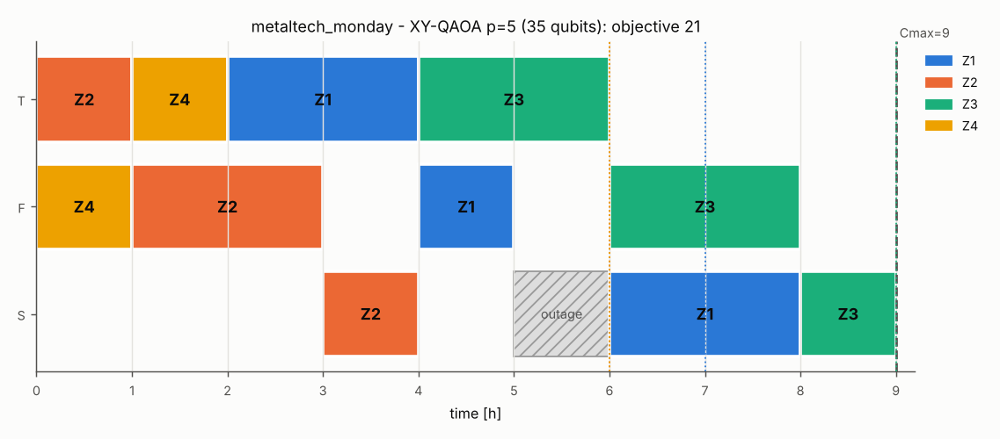

# MetalTech production scheduling on a quantum simulator and QUBO solvers

QPoland Quantum Hackathon 2026 - ERP challenge. Job-shop scheduling as an exact time-indexed QUBO,
solved with QAOA on state-vector simulators and with QUBO solvers. Stage 2 extends it to a realistic
factory model: setups, maintenance, due dates, job-specific routes, breakdowns with rolling
re-planning, and a second milling machine.

**Demo video:** _add the link to the recorded demo here (unlisted YouTube / Drive link)._

| document | content |
|---|---|
| [`PROJECT_DESIGN.md`](PROJECT_DESIGN.md) | data model, QUBO, proofs, qubit reduction, solvers |
| [`DEVELOPMENT_LOG.md`](DEVELOPMENT_LOG.md) | dated development log: steps, problems, decisions |
| [`VELOXQ.md`](VELOXQ.md) | everything about VeloxQ: setup, the five uses, results, decomposition, lessons, cost |
| [`results/baseline/report.md`](results/baseline/report.md) | Stage-1 results for instances A and B |
| [`results/extension/`](results/extension/) | Stage-2 results (one markdown report per experiment) |
| [`schedule_2x2.json`](schedule_2x2.json), [`schedule_3x3.json`](schedule_3x3.json) | the required schedule files (Section 14 format) |

---

## Results at a glance

### Stage 1 - baseline

| | instance A (2x2) | instance B (3x3) |
|---|---|---|
| optimum (CP-SAT, brute force, lower bound) | 4 | 8 |
| QUBO | time-indexed, H = 5 (the ERP's FIFO plan), **12 qubits** | time-indexed, H = 8, **33 qubits** (72 naive, 39 windows) |
| quantum algorithm | QAOA, X mixer, p = 6, exact state vector | XY-mixer QAOA, p = 4, exact simulation in the 103,680-dim one-hot subspace |
| P(optimal) per shot | 0.099 (uniform: 0.00024) | 0.172 (uniform: 0.00013) |
| **result** | **makespan 4** -> `schedule_2x2.json` | **makespan 8** -> `schedule_3x3.json` |
| cross-checks | ground states certified over all 2^12 states; Qiskit circuit agrees to 1e-16 | ground states certified; 24-qubit domain-wall QUBO certified over all 2^24 states; SA, tabu and **VeloxQ** on the 72-, 39-, 33-, 24-qubit QUBOs and the 3-qubit job-order code (VeloxQ optimal reads 13% / 93% / 99% / 94% / 100%, makespan 8 in every call) |
| fewest qubits (job-order code, comparison only) | **1 qubit** | **3 qubits**, certified over all 2^3 states; coefficients come from brute force over the 6 job orders |

**Fewest qubits for the baseline 3x3: 3**, with the job-order code (`erpq/permutation.py`). Three bits
number the 3! = 6 job orders, and the energy of each code is the makespan of that order:
E = 8 + x0 - x0*x1 + 2*x1*x2. All 2^3 states are certified: the 4 ground states are the 4 optimal
orders. X-mixer QAOA at p = 3 reaches P(optimal) 0.994, but uniform sampling already gives 0.5. The
catch: the coefficients are the makespans of all 6 orders, computed classically, so brute force has
solved the problem before the QUBO exists, and the table grows as n!. The qubits hold only the job
order; start times are decoded classically. It is therefore reported for comparison only
([`PROJECT_DESIGN.md`](PROJECT_DESIGN.md) §5.6).

**Our smallest time-indexed QUBO for the baseline 3x3: 24 qubits** (72 naive -> 39 start windows -> 33
singleton arc consistency -> 24 domain-wall encoding). Every step is exact and polynomial to construct,
and the 24-qubit QUBO is certified correct by enumerating all 2^24 states. Minimality is not claimed.
This is the model behind the schedules and Stage 2.

### Stage 2 - extension

One integrated model, **`metaltech_monday`** (`instances/extension/metaltech_monday.json`): a job
shop with 4 jobs (Z4 has its own route, milling then turning), two part families with 1 h
changeovers on F and S, planned maintenance of S in [5, 6), and due dates with customer weights. The
objective is 2 x makespan + weighted tardiness (cost units: 2 per hour of shop time, w_j per hour
late). It is built up feature by feature from the 3x3 baseline, and every experiment runs on it or on
random instances of the same model:

| experiment | headline result | report |
|---|---|---|
| **Price of realism / qubit reduction** | Integrated model: **102 naive -> 62 windows -> 35 SAC -> 24 domain-wall qubits**, every step certified exact (QUBO optimum 21 = CP-SAT). Due dates cost **0 qubits** (linear terms). At a fixed horizon, maintenance windows and running operations only *remove* variables; they cost qubits indirectly by forcing a longer horizon (+1 h here). A second milling machine costs +45 qubits. Horizon ascent proves H = 7 and 8 infeasible with propagation alone. | [`reduction.md`](results/extension/reduction.md) |
| **Algorithm comparison** | XY-mixer QAOA on 35 qubits (exact simulation, 331,776-dim subspace): P(optimal) **9.8%** at p = 4 with the CVaR(0.1) loss vs 0.008% for uniform sampling (about 1,200x). Angles transferred from the 3x3 with no re-optimisation: 4.2% (own optimisation: 4.5%). Success per read on the 102 / 62 / 35 / 24-qubit QUBOs: SA **7.8% -> 33% -> 43% -> 83%**; **VeloxQ** (live cloud runs, 3 calls each) **4.3% -> 47% -> 69% -> 78%**, every call reaching the optimum; tabu 100% for <= 62 qubits. Penalty sweep: the provable U+1 is exact; 4x larger penalties lower SA success from 0.43 to 0.26. | [`algorithms.md`](results/extension/algorithms.md) |
| **Scaling and variance** | 2-6 jobs x 5 random instances x seeds: naive qubits 53 -> 257, domain wall 14 -> 157; SA success per read on the domain-wall QUBO 0.78 -> 0.004 (mean +/- sd per size in the report); XY-QAOA (p = 3, transferred angles + refinement) amplifies P(optimal) about 30x over uniform where it can be simulated. | [`scaling.md`](results/extension/scaling.md) |
| **Disruptions and rolling re-planning** | 36 breakdown scenarios (machine x time x duration): the rolling QUBO re-plan equals the CP-SAT optimum in **100%** of scenarios, with SA and with **XY-QAOA run on fixed angles** (no variational loop at re-planning time; the 3 residuals whose subspace exceeds 2e6 states fall back to SA). It is never worse than the ERP's right-shift repair and better by 0.97 cost units on average (31% of scenarios improved). Residual QUBOs: median 18.5 qubits. Re-planned **live on VeloxQ** (63 calls): 33 / 36 optimal. | [`disruption.md`](results/extension/disruption.md) |
| **Second milling machine?** | 40 order books: saves **10.5 cost units/day** (95% CI 9.0-12.1); the QUBO solution is optimal in 80/80 solves. Under illustrative, configurable cost assumptions: payback about 1.1 years. | [`investment.md`](results/extension/investment.md) |
| **VeloxQ at scale** | Order books with 4-12 jobs (74-726 qubits). One call on the whole QUBO is optimal up to 6 jobs; from 8 jobs on, the best plans of VeloxQ and SA are 17-59% above the optimum. **Decomposition** into small exact sub-QUBOs, 8 per VeloxQ call, gets within 0-15% (VeloxQ: optimal on 8 jobs in 5 calls) and SA within 0-8%. See [VeloxQ](#veloxq). | [`veloxq.md`](results/extension/veloxq.md) |



---

## How to run

Requires Python >= 3.10 (tested with 3.13 on Linux and 3.12 on Windows).

```bash
git clone https://github.com/saifibnaezhararko/qpoland-hackathon-test.git && cd qpoland-hackathon-test
python -m venv .venv && source .venv/bin/activate     # Windows: .venv\Scripts\activate
pip install -r requirements.txt
```

On Windows PowerShell, `Activate.ps1` fails when script execution is disabled. Then skip the
activation and use `.venv\Scripts\python.exe` in place of `python` in every command below (for the
install: `.venv\Scripts\python.exe -m pip install -r requirements.txt`).

`requirements.txt` has lower bounds only. The committed results were produced with numpy 2.5.4,
scipy 1.18.1, matplotlib 3.11.2, ortools 9.15.6755, dimod 0.12.22, dwave-samplers 1.8.0, qiskit 2.6.0
and pytest 9.1.1; pin these to reproduce the sampler statistics bit for bit.

### Stage 1 (writes `schedule_2x2.json`, `schedule_3x3.json`, `results/baseline/`)

```bash
python run_baseline.py           # full run, ~2 minutes
python run_baseline.py --quick   # lower QAOA depth, ~30 seconds (overwrites the schedule files!)
python run_baseline.py --quick --out /tmp/try   # writes report AND schedules to /tmp/try instead
```

The script prints the QUBO sizes, the QAOA convergence, the decoded schedules (ASCII Gantt) and a
final independent re-validation of both JSON files. Charts: `results/baseline/gantt_*.png`. Other
options: `--shots` (default 4096), `--seed` (default 7), `--veloxq` (see [VeloxQ](#veloxq)).

### Stage 2 (writes `results/extension/`)

```bash
python run_extension.py all             # all five experiments (~30 minutes on 4 cores)
python run_extension.py all --quick     # reduced statistics (~10 minutes)
python run_extension.py reduction       # or a single part: reduction | algorithms | scaling | disruption | investment
python run_extension.py veloxq          # Part 6, VeloxQ at scale (needs VELOX_TOKEN, see VeloxQ below)
python run_extension.py all --quick --out /tmp/ext   # write elsewhere; results/extension/ stays untouched
python run_extension.py replot          # rebuild charts and markdown from the saved JSON (~30 seconds)
```

Part 5's economic assumptions are flags (defaults shown):
`python run_extension.py investment --cost-unit-pln 150 --days-per-year 250 --machine-cost-pln 450000`.
`--shots` (default 4096) sets the shots of the Part-2 QAOA variants.

### Live demo (~1 minute)

```bash
python demo.py
python demo.py --veloxq   # adds step 5: the breakdown re-planned live on VeloxQ (needs VELOX_TOKEN)
```

### Tests

```bash
python -m pytest -q
```

The tests (46) check:
* the validator and the raw schedule files;
* that sampler results are mapped back by label, also from SPIN answers (how VeloxQ returns them);
* the reference sizes (72 / 39 / 33 / 24);
* the job-order code: 3 qubits for instance B, exact there and on random 3- and 4-job flow shops (all
  2^n states enumerated), and refused for extended instances;
* ground-state optimality on random extended instances against CP-SAT, including the unpruned levels
  with unary constraints;
* that pruning keeps every feasible schedule;
* that bad arguments are not mistaken for infeasibility proofs;
* the domain-wall equivalence, the adjoint gradients and the Qiskit cross-checks;
* horizon ascent and rolling re-planning;
* the decomposition: a sub-QUBO's objective is the full objective up to a constant, the block-diagonal
  batch QUBO is the sum of its blocks, and the search never leaves feasibility or gets worse.

### VeloxQ

The QUBOs are also solved on **VeloxQ** through the official SDK. VeloxQ is Quantumz.io's classical
QUBO solver running on GPUs (default backend: one H100). The full account, with setup, all results,
the decomposition design, lessons and cost, is in [`VELOXQ.md`](VELOXQ.md).

```bash
pip install veloxq-sdk
export VELOX_TOKEN=<your token>            # Windows PowerShell: $env:VELOX_TOKEN="<your token>"
python run_baseline.py --veloxq            # adds VeloxQ to the 3x3 cross-checks
python run_extension.py algorithms --veloxq
python run_extension.py disruption --veloxq   # adds a live VeloxQ re-planning column
python run_extension.py veloxq             # Part 6: VeloxQ at scale and decomposition
```

`erpq/solvers/samplers.py:veloxq` uploads the QUBO as a BINARY `dimod.BinaryQuadraticModel`. It maps
the returned states back by label and recomputes the energies locally. Every sample is then decoded
and checked by the validator, like any other solver's. Without a token this path is skipped.

**Where VeloxQ is used.** VeloxQ is not a side note here; it runs in five places, always on the same
QUBOs as the other solvers and always behind the same validator:

1. Stage 1: the 3x3 cross-checks, on all five formulations (72 / 39 / 33 / 24 qubits and the 3-qubit
   job-order code).
2. Part 2: the solver comparison on `metaltech_monday`, 4 formulations x 3 calls, with TTS99.
3. Part 4: rolling re-planning after 36 breakdowns, as a live solver column.
4. Part 6: one call on the whole QUBO of 4-12-job order books (up to 726 qubits), plus the solver
   settings that could help.
5. Part 6: **decomposition** (`erpq/decompose.py`), where every VeloxQ call solves 8 small exact
   sub-QUBOs stacked into one block-diagonal QUBO.

Stage 1 and Part 2 (`veloxq-sdk` 1.1.0, 1024 reads x 5000 steps per call; share of reads that decode
to an optimal schedule; 3x3 re-run on 2026-10-18, Monday on 2026-10-17):

| instance | naive | windows | SAC | SAC + domain wall | job-order code |
|---|---|---|---|---|---|
| 3x3, qubits | 72 | 39 | 33 | 24 | 3 |
| VeloxQ (1 call) | 12.9% | 93.1% | 98.5% | 94.1% | 100% |
| SA (500 reads, for comparison) | 39.6% | 91.6% | 96.6% | 94.2% | 100% |
| metaltech_monday, qubits | 102 | 62 | 35 | 24 | - |
| VeloxQ (mean of 3 calls) | 4.3% | 46.7% | 69.0% | 77.8% | - |
| SA (mean of 10 seeds) | 7.8% | 32.7% | 42.7% | 82.7% | - |

* Every VeloxQ call returned an optimal schedule (3x3: makespan 8; Monday: objective 21 = CP-SAT).
* The exact qubit reductions help VeloxQ too: on the Monday QUBOs its success per read rises from 4.3%
  (102 qubits) to 77.8% (24 qubits).

**Live re-planning (Part 4, 2026-10-18).** The re-planning loop is the same horizon ascent as in the SA
column, with one VeloxQ call (1024 reads) per horizon that has qubits. Over 36 breakdowns this made 63
live calls, 7.5 s of solver time in total:

| re-plan solver | equals CP-SAT | mean gain over right-shift | worse than right-shift |
|---|---|---|---|
| SA | 36 / 36 | 0.97 | 0 |
| XY-QAOA (fixed angles, SA fallback) | 36 / 36 | 0.97 | 0 |
| VeloxQ (live) | 33 / 36 | 0.67 | 1 |

The three misses are residual QUBOs where VeloxQ's reads end in a local minimum. One example has 31
qubits: VeloxQ's best energy is 16 against a ground energy of 12, and 22% of its reads are feasible
(SA: 86%). Four times more steps did not change that. A production loop would keep the right-shift
plan whenever the re-plan is worse.

**At scale (Part 6, 2026-10-18, [`veloxq.md`](results/extension/veloxq.md)).** Random order books with
4-12 jobs, with the CP-SAT optimum as the reference:

| jobs | whole-QUBO qubits | optimum | SA, whole QUBO | VeloxQ, whole QUBO | VeloxQ decomposition | SA decomposition |
|---|---|---|---|---|---|---|
| 4 | 74 | 43 | 43 | 43 | - | - |
| 6 | 130 | 24 | 24 | 24 | - | - |
| 8 | 272 | 38 | 49 | 50 | **38** (5 calls, 1.2 s) | 41 (88 s) |
| 10 | 415 | 54 | 63 | 66 | 55 (30 calls, 3.7 s) | **54** (13 s) |
| 12 | 726 | 106 | 155 | 169 | 122 (30 calls, 3.6 s) | **108** (29 s) |

* **Whole QUBO:** one call finds the optimum up to 6 jobs (130 qubits). From 8 jobs on, neither VeloxQ
  nor SA comes close (17-59% above the optimum). More steps, rescaled coefficients and lower penalties
  do not close the gap. The best of them, penalty x0.25, reached 44 vs 38, and it gives up the
  exactness guarantee.
* **Decomposition** (`erpq/decompose.py`) closes most of the gap. Each step re-optimises 6 jobs as a
  small exact sub-QUBO. Each VeloxQ call solves 8 of them as one block-diagonal QUBO (up to 1,062
  qubits per call), so 30 calls explore 240 neighbourhoods. Times in brackets are VeloxQ's solver time
  as reported by the service and SA's local time.
* **Verdict:** VeloxQ's decomposition reached the optimum of the 8-job book in 5 calls, where SA's
  stalled at 41. On 10 and 12 jobs SA's decomposition got closer (54 vs 55, 108 vs 122), using 3.5x and
  8x more solver time. These are single instances on an unseeded service: a trend, not a statistic.

**Accounting.** Every VeloxQ job is visible in the account. On 2026-10-17 and 2026-10-18 the project made
277 calls, 41.1 s of solver time in total (41,105 quota units; the cost shown is 0 USD). 158 of the
calls are behind the committed results: baseline 5, Part 2 12, Part 4 63, Part 6 78. The rest were
smoke tests, pilots, diagnostics, a superseded run and the demo, all recorded in `DEVELOPMENT_LOG.md`.

* The service reports 0.1-0.6 s of solver time per call (it grows slowly with size); every call also
  takes a few seconds of upload, queueing and download. TTS99 [s] uses the solver time.
* The service takes no seed, so a rerun gives slightly different rates.
* VeloxQ is a classical GPU solver: these are not quantum-hardware results.

### Solving your own instance

```python
from erpq.model import Instance
from erpq.timeindexed import build_time_indexed_qubo
from erpq.pipeline import run_qaoa_xy
from erpq.solvers.samplers import simulated_annealing
from erpq.pipeline import report_samples

inst = Instance.load("instances/instance_3x3.json")
form = build_time_indexed_qubo(inst, horizon=8, pruning="sac")       # 33 qubits
_, rep = run_qaoa_xy(form, p=3)                                       # XY-mixer QAOA
rep.best.save("my_schedule.json", "instance_3x3")
rep2 = report_samples(form, simulated_annealing(form.qubo, 100))     # or any QUBO solver
```

---

## Input and output format

Instances use the challenge schema (Section 14), e.g. `instances/instance_3x3.json`. Optional fields
extend it. `machines`, `family`, `due_date`, `weight`, `setup_times`, `unavailability` and `objective`
are used in `instances/extension/`. The rolling-state fields `release`, `machine_ready`, `time_origin`
and `fixed` are produced by the re-planning code (e.g. `results/extension/residual_t2_F2.json`):

```json
{
  "problem": "erp_scheduling",
  "machines": [{"id": "T", "type": "T"}, {"id": "F1", "type": "F"}, {"id": "F2", "type": "F"}, {"id": "S", "type": "S"}],
  "jobs": [{"id": "Z1", "family": "A", "due_date": 7, "weight": 3, "release": 0,
            "operations": [{"machine": "T", "duration": 2}, {"machine": "F", "duration": 1}]}],
  "setup_times": {"F": {"A": {"B": 1}, "B": {"A": 1}}},
  "unavailability": [{"machine": "S", "start": 5, "end": 6}],
  "objective": {"makespan": 2, "weighted_tardiness": 1}
}
```

Schedules are written exactly in the Section-14 format (`instance`, `method`, `makespan`, `schedule`
with `job`, `machine`, `start`, `end`; integer hours from 0, end = start + duration). For extended
instances, an `operation` index and an objective breakdown are added.

---

## Repository structure

```
erpq/                 the package (see PROJECT_DESIGN.md Sec. 8 for a per-file description)
  model.py            instance data model / JSON schema
  schedule.py         independent feasibility checker, Section-14 output
  timeindexed.py      time-indexed QUBO + pruning (windows, AC-3, SAC)
  domainwall.py       domain-wall re-encoding
  horizon.py          horizon ascent + certificate
  rolling.py          disruption -> residual problem, right-shift repair
  decompose.py        decomposition of large order books into small exact sub-QUBOs (batched for VeloxQ)
  classical.py        CP-SAT reference
  heuristics.py       bounds, FIFO / NEH / EDD heuristics, brute force
  solvers/            QAOA simulators (X and XY mixers), Qiskit cross-check, SA / tabu / VeloxQ
instances/            instance_2x2.json, instance_3x3.json, extension/*.json
run_baseline.py       Stage 1 pipeline
run_extension.py      Stage 2 experiments
demo.py               live demo
tests/                pytest suite
results/              generated reports, JSON and charts
```

---


## How AI was used

This project was built with an AI coding agent (**Claude Code**, Anthropic), driven by the team through natural-language instructions, specifically to implement and experiment on the mandatory baseline[cite: 1, 3]. Beyond the baseline, all extensions, novel modeling, architectural design decisions, and core implementations were carried out independently by the authors. The AI agent read the challenge PDFs, proposed initial baseline code, run scripts, and helped debug early failures recorded in the development log[cite: 1]. AI output was strictly verified and never taken on trust:

- every quantum or QUBO result is checked by a validator that is independent of the QUBO encoding (it shares only the instance accessors `setup()` / `fixed_conflict()`), and compared with CP-SAT and (for the baselines) brute force[cite: 1];
- the claimed exactness of each QUBO is checked by exhaustive enumeration (all $2^n$ states, or the one-hot subspace plus the penalty theorem)[cite: 1];
- the custom simulators are checked against Qiskit gate-level circuits, and the analytic gradients against finite differences[cite: 1];
- the reference numbers from the challenge (72 and 39 variables, optimum 8) are reproduced in tests[cite: 1, 4].

Problems found along the way, and how they were fixed, are listed with timestamps in `DEVELOPMENT_LOG.md`[cite: 1, 5]. They include a crash on partial schedules, overlapping outage windows that made CP-SAT infeasible, inconsistent setup handling after running operations, a weak horizon certificate, a scaling design that blew up, an implicit SPIN/BINARY default in the VeloxQ call, and Windows line endings in the generated files[cite: 1]. The team takes full responsibility for the entirety of the project and its codebase; `PROJECT_DESIGN.md` is written to reflect this deep understanding[cite: 1, 5, 6].
---

## License

MIT, see [`LICENSE`](LICENSE).
