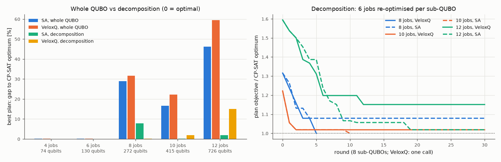

# VeloxQ in the MetalTech scheduling project

QPoland Quantum Hackathon 2026, ERP challenge. This document covers how the project uses **VeloxQ**,
Quantumz.io's GPU-based QUBO solver:

* the setup;
* the five places it runs, with all results;
* the decomposition we built around it;
* what we learned, what it cost, and where it did not help.

Every number comes from the result files named in each section. The dated history is in
[`DEVELOPMENT_LOG.md`](DEVELOPMENT_LOG.md) (2026-10-17 from 12:15, and 2026-10-18).

## Summary

* **Same footing as every other solver.** VeloxQ runs in five places, on the same QUBOs as simulated
  annealing (SA), tabu search and QAOA. Every read goes through the same independent validator and is
  compared with CP-SAT.
* **The baseline 3x3 and the integrated Monday model (3-102 qubits):** every VeloxQ call returned an
  optimal schedule. On the Monday model VeloxQ has the highest success per read on the 62- and
  35-qubit QUBOs (47% and 69%, vs 33% and 43% for SA), and its TTS99 is 0.3-13 ms of solver time.
* **Live re-planning after 36 machine breakdowns:** 63 calls, CP-SAT optimum in 33 of 36 scenarios.
* **Large order books (8-12 jobs, 272-726 qubits):** the best single call of any solver stays 17-59%
  above the optimum.
  - Our **decomposition** packs 8 small exact sub-QUBOs into one block-diagonal QUBO per VeloxQ call,
    and closes most of that gap.
  - VeloxQ solved the 8-job book to optimality in 5 calls (1.2 s of solver time).
* **Cost:** 277 calls over two days, 41.1 s of solver time (41,105 quota units, 0 USD).
* **Where VeloxQ was weaker, we say so:**
  - 3 of the 36 re-plans end in a local minimum;
  - on 10 and 12 jobs the SA-driven decomposition got closer to the optimum.

| # | where | what VeloxQ does | headline |
|---|---|---|---|
| 1 | Stage 1, instance B (3x3) | cross-check on 5 formulations | makespan 8 (optimal) in every call |
| 2 | Part 2, `metaltech_monday` | solver comparison, 4 formulations x 3 calls | best success per read at 62 / 35 qubits; TTS99 0.3-13 ms |
| 3 | Part 4, breakdowns | live re-planning solver, 36 scenarios | 33 / 36 optimal, 63 calls |
| 4 | Part 6, 4-12-job books | one call on the whole QUBO, plus settings | optimal up to 6 jobs; the formulation, not the solver, limits beyond |
| 5 | Part 6, decomposition | 8 sub-QUBOs per call | 8 jobs: optimal in 5 calls |

---

## 1. Setup

```bash
pip install veloxq-sdk                    # 1.1.0
export VELOX_TOKEN=<your token>           # PowerShell: $env:VELOX_TOKEN="<your token>"
```

The token is read from the environment only. No file in the repository contains it.

The adapter is `erpq/solvers/samplers.py:veloxq`.
* It converts our `QUBO` to a `dimod.BinaryQuadraticModel` with integer labels 0..n-1.
* It calls `VeloxQSolver(parameters=VeloxQParameters(num_rep, num_steps)).sample(bqm, vartype="BINARY")`
  on the default backend `VeloxQH100_1` (one H100). The default is 1024 reads x 5000 steps.
* It passes `vartype="BINARY"` explicitly, because the SDK treats in-memory problems as SPIN by
  default. Any SPIN answer is mapped back with x = (s + 1) / 2.
* It maps states back by label (the service returns labels as strings) and recomputes every energy
  locally. They agree with the energies the service reports, offset included.
* It records the solver time the service reports (`info["solver_time_s"]`) separately from the client
  wall time.

**Verification** is the same for every solver:
1. each read is decoded to a schedule;
2. the schedule is checked by `Schedule.violations()`, which is independent of the QUBO encoding;
3. its objective is compared with OR-Tools CP-SAT on the same model.

A sampler's result is never called optimal on its own.

**Reproduce.** Each command needs the token; without it the VeloxQ steps print "skipped". The service
takes no seed, so a rerun gives slightly different numbers.

| what | command | VeloxQ calls |
|---|---|---|
| Stage 1 cross-checks | `python run_baseline.py --veloxq` | 5 |
| Part 2 comparison | `python run_extension.py algorithms --veloxq` | 12 |
| Part 4 re-planning | `python run_extension.py disruption --veloxq` | about 63 |
| Part 6 at scale and decomposition | `python run_extension.py veloxq` | about 80 |
| live demo | `python demo.py --veloxq` | 3 |

---

## 2. Stage 1: the baseline 3x3 ([`results/baseline/report.md`](results/baseline/report.md))

Instance B (3 jobs x 3 machines, optimum 8) at H = 8, one call per formulation (2026-10-18):

| formulation | qubits | VeloxQ optimal reads | VeloxQ feasible reads | SA optimal (500 reads) | solver time [s] | wall time [s] |
|---|---|---|---|---|---|---|
| naive | 72 | 12.9% | 17.1% | 39.6% | 0.126 | 4.5 |
| start windows | 39 | 93.1% | 93.1% | 91.6% | 0.127 | 2.8 |
| SAC | 33 | 98.5% | 98.5% | 96.6% | 0.126 | 2.9 |
| SAC + domain wall | 24 | 94.1% | 94.1% | 94.2% | 0.123 | 2.4 |
| job-order code (comparison only) | 3 | 100% | 100% | 100% | 0.124 | 2.4 |

* Every call returned makespan 8.
* The first live round (2026-10-17) gave 15.0 / 93.2 / 98.4 / 94.7% on the four time-indexed QUBOs.
* The job-order code's coefficients come from brute force over all 6 job orders. It is a comparison,
  not our model.

---

## 3. Part 2: solver comparison on `metaltech_monday` ([`results/extension/algorithms.md`](results/extension/algorithms.md))

The integrated Stage-2 model: 4 jobs, setups, maintenance, due dates and job-specific routes. The
optimum is 21 at the certified horizon H* = 9. There were 3 independent calls per formulation
(2026-10-17).

| formulation | qubits | VeloxQ P(optimal) per read | SA | tabu | VeloxQ TTS99 [s] | SA TTS99 [s] |
|---|---|---|---|---|---|---|
| naive | 102 | 4.3% | 7.8% | 19.0% | 0.0126 | 0.2462 |
| start windows | 62 | **46.7%** | 32.7% | 100% | 0.0009 | 0.0244 |
| SAC | 35 | **69.0%** | 42.7% | 100% | 0.0005 | 0.0090 |
| SAC + domain wall | 24 | 77.8% | 82.7% | 100% | 0.0003 | 0.0017 |

* Every call reached objective 21.
* Our exact qubit reductions help VeloxQ the most: from 102 to 24 qubits its success per read rises
  from 4.3% to 77.8%.
* TTS99 is the number of reads needed for 99% confidence, times the time per read. The time bases
  differ:
  - VeloxQ: the solver time the service reports;
  - SA: the local wall clock on one CPU core;
  - tabu: set by its 20 ms timeout.
* Each VeloxQ call also takes about 6 s of upload, queueing and download.

---

## 4. Part 4: live re-planning after breakdowns ([`results/extension/disruption.md`](results/extension/disruption.md))

**The scenarios.** The optimal Monday plan is executed until a machine breaks down: T, F or S, at
t = 1-4, for 1-3 h. That gives 36 scenarios.

**The re-planning loop.** The remaining work is re-planned as a new QUBO by horizon ascent:
* the horizon grows from the lower bound;
* propagation proves short horizons infeasible without any solver call;
* each horizon that has qubits is solved by one VeloxQ call (1024 reads).

Residual QUBOs have up to 51 qubits.

| re-plan solver | equals CP-SAT | mean gain over right-shift [cost units] | worse than right-shift |
|---|---|---|---|
| SA | 36 / 36 | 0.97 | 0 |
| XY-QAOA (fixed angles, SA fallback) | 36 / 36 | 0.97 | 0 |
| **VeloxQ (live)** | **33 / 36** | 0.67 | 1 |

* 63 live calls (0-3 per scenario), 7.51 s of solver time in total.
* **Misses:**
  - t = 3, S down 2 h and 3 h: 34 vs 30;
  - t = 4, T down 3 h: 33 vs 30. Here the VeloxQ re-plan is worse than the ERP's right-shift repair
    (30). A production loop would keep the better of the two.
* **Diagnosis** (t = 3, S down 3 h):
  - at H = 12 (31 qubits) and H = 13 (39 qubits) VeloxQ's best read has energy 16, while SA and exact
    enumeration reach the ground energy 12;
  - only 22-23% of VeloxQ's reads are feasible (SA: 86-88%);
  - 4x more steps gave the same result;
  - the energies agree with ours, so the cause is the energy landscape, not the adapter.
* **Read count.** The first run used 256 reads per call and got 32 / 36, at the same total solver
  time (7.62 s). At these sizes a call costs about 0.12 s regardless of the read count, so
  re-planning uses 1024 reads.

---

## 5. Part 6: VeloxQ at scale ([`results/extension/veloxq.md`](results/extension/veloxq.md))

Random order books of the same extended model: due dates, setups, job-specific routes and a
maintenance window, using instance k = 0 of each size. Each book is planned within one shift
(horizon = optimal makespan + 1 h), with CP-SAT on the same horizon as the reference.

### 5.1 One call on the whole QUBO

| jobs | operations | qubits | couplings | optimum | SA best (600 reads) | VeloxQ best (1024 reads) | VeloxQ feasible reads | VeloxQ solver time [s] |
|---|---|---|---|---|---|---|---|---|
| 4 | 11 | 74 | 532 | 43 | 43 | 43 | 40.5% | 0.125 |
| 6 | 15 | 130 | 1,344 | 24 | 24 | 24 | 14.0% | 0.126 |
| 8 | 21 | 272 | 4,679 | 38 | 49 | 50 | 21.3% | 0.183 |
| 10 | 27 | 415 | 9,208 | 54 | 63 | 66 | 5.7% | 0.499 |
| 12 | 33 | 726 | 24,778 | 106 | 155 | 169 | 0.1% | 0.549 |

Up to 6 jobs both solvers find the optimum; from 8 jobs on their best plans are 17-59% above it. The
reason is the formulation, not the solver. The provable penalty (U + 1 = 94 for 8 jobs, 292 for 12) is large
compared with objective steps of 1-3, so moving one operation means climbing a penalty barrier.

### 5.2 VeloxQ settings (one call each, best plan)

| jobs | optimum | default 1024 x 5000 | 4x steps | penalty x0.5 | penalty x0.25 | coefficients scaled to max 1 |
|---|---|---|---|---|---|---|
| 8 | 38 | 50 | 49 | 48 | 44 | 50 |
| 10 | 54 | 66 | 66 | 64 | 63 | 60 |

* No setting closes the gap.
* Lower penalties help a little, but give up the guarantee that ground states are optimal.
* Rescaling stays within the spread between identical calls: the 10-job default call gave 60 in a
  pilot and 66 here.
* The SDK's second solver, `SBMSolver` (simulated bifurcation), is not enabled for our account
  (HTTP 401).

### 5.3 Decomposition: small exact QUBOs, 8 per call

`erpq/decompose.py` turns the large problem into a sequence of small exact ones:

1. **Neighbourhood.** Free 6 jobs. Every operation of the other jobs stays fixed at its planned time,
   as an `Instance.fixed` entry. A fixed entry blocks its unit, including the setup gaps before and
   after it; these are the same semantics as a running operation in re-planning.
2. **Sub-QUBO.** SAC-pruned, with the provable penalties U + 1. Its objective is the full objective up
   to a constant: the makespan and the lower bound include the fixed operations, and a fixed job's
   tardiness does not change. So its ground states are the best re-placements of the 6 jobs. This is
   tested in `tests/test_decompose.py`.
3. **Batching for VeloxQ.** Each round draws 8 neighbourhoods of the current plan and stacks their
   sub-QUBOs into one block-diagonal QUBO, with no couplings between blocks. One call solves all 8.
   - The best read is taken per block, which is valid because the blocks are independent.
   - Why batch: at this scale a call's solver time barely grows with size, but every call pays a
     network round trip of several seconds.
4. **Acceptance.** Candidates are tried best first. Each is merged into the current plan and kept only
   if the merged plan passes the validator of the original instance and is not worse. The current
   placement is always feasible for a sub-problem, so the plan never gets worse and never leaves the
   horizon.

SA gets the same 8 neighbourhoods per round (same seed, same start plan) and solves them one after
another. The search runs up to 30 rounds and stops early at the CP-SAT optimum, only to save calls.
The start plan is the best read of the whole-QUBO VeloxQ call.

| jobs | optimum | start plan | VeloxQ decomposition | VeloxQ calls | qubits per call (median / max) | VeloxQ solver time | VeloxQ wall time | SA decomposition | SA time |
|---|---|---|---|---|---|---|---|---|---|
| 8 | 38 | 50 | **38 (optimal)** | 5 | 940 / 1,062 | 1.23 s | 53 s | 41 | 88 s |
| 10 | 54 | 66 | 55 (+1.9%) | 30 | 460 / 633 | 3.66 s | 219 s | **54** | 13 s |
| 12 | 106 | 169 | 122 (+15.1%) | 30 | 368 / 643 | 3.56 s | 217 s | **108** | 29 s |

* **Decomposition is what makes these sizes tractable.** The start plans are 22-59% above the
  optimum. The decomposition brings that down to 0-15% with VeloxQ and 0-8% with SA.
* **VeloxQ vs SA:**
  - VeloxQ's decomposition reached the 8-job optimum in 5 calls, where SA's stalled at 41 after 30
    rounds.
  - On 10 and 12 jobs SA's got closer, using 3.5x and 8x more solver time. VeloxQ's sub-QUBO answers
    are sometimes stuck in local minima, as in Part 4.
* **Cost per call.** One VeloxQ call explored 8 neighbourhoods (up to 1,062 qubits) in 0.12-0.25 s of
  solver time. A round took 7-11 s of wall time, mostly the network round trip.
* **Read count.** VeloxQ ran these with 256 reads per call. At 400-1,000 qubits per call, 1024 reads
  would cost up to 0.5 s instead of 0.12 s.
* **Caveat.** These are single instances on an unseeded service: a trend, not a statistic.

The chart below shows, on the left, the gap to the optimum for the whole QUBO vs the decomposition.
On the right it shows the decomposition rounds (VeloxQ solid, SA dashed).



---

## 6. Live demo

`python demo.py --veloxq` runs the standard demo and adds step 5: the t = 2 milling breakdown,
re-planned live on VeloxQ. Recorded on 2026-10-18:
* objective 33, equal to CP-SAT (the ERP's right-shift gives 34);
* certified at H = 13;
* 3 calls, 0.34 s of solver time;
* 83 s for the whole demo.

---

## 7. What we learned about using VeloxQ

1. **Solver time has a floor.** A call costs about 0.12 s up to about 130 qubits, whether it makes
   256 or 1024 reads. Beyond that it grows slowly: 0.18 s at 272 qubits, 0.50-0.55 s at 415-726 qubits
   (1024 reads). On small problems, ask for 1024 reads: they are free.
2. **Latency dominates.** Each call takes 2-16 s of wall time (upload, queueing, download) against
   0.1-0.6 s of solver time. Batch work into few calls. Stacking independent sub-problems into one
   block-diagonal QUBO is exact and cheap.
3. **Formulation beats tuning.** Exact qubit reductions raise VeloxQ's success per read from 4.3% to
   77.8% on the Monday model. Steps, rescaling and penalty tweaks change little.
4. **Penalty landscapes can trap it.** On a few small residual QUBOs, VeloxQ's reads end in a local
   minimum that SA escapes, and more steps did not help. Always validate, and keep a fallback.
5. **Report solver time and wall time separately.** TTS99 on the client wall clock would measure our
   internet connection.
6. **The service is unseeded.** Repeat calls and report the spread. We never call a result optimal
   without CP-SAT.

---

## 8. Cost

| day | calls | quota units | solver time |
|---|---|---|---|
| 2026-10-17 | 19 | 2,307 | 2.3 s |
| 2026-10-18 | 258 | 38,798 | 38.8 s |
| **total** | **277** | **41,105** | **41.1 s** |

* The service bills about 1 quota unit per millisecond of solver time, and the cost shown is 0 USD.
* 158 calls are behind committed results: baseline 5, Part 2 12, Part 4 63, Part 6 78.
* The other 119 are all recorded in `DEVELOPMENT_LOG.md`:
  - 2026-10-17: smoke tests (2), the first baseline round (4) and the ad hoc job-order call (1);
  - 2026-10-18: pilots and diagnostics (46), the superseded 256-read Part 4 run (63) and the demo test
    (3).

---

## 9. Limitations

* VeloxQ is a classical GPU solver, so none of this is quantum hardware. The QAOA results in this
  project are noiseless simulations.
* The service takes no seed, and Part 6 uses one instance per size. Read the at-scale results as a
  trend.
* The decomposition finds good plans, not certificates. Optimality there is judged against CP-SAT.
* In 3 of the 36 re-plans VeloxQ ends above the optimum, and once above the right-shift repair.
* Only the default backend (one H100) and the VeloxQ solver were used. The SBM solver is not enabled
  for our account, and the multi-GPU backends listed in the SDK were not tried.

---

## 10. Files

| file | role |
|---|---|
| `erpq/solvers/samplers.py` | `veloxq()` adapter, `veloxq_available()` |
| `erpq/experiments.py` | `sampler_trials` (repeated calls, TTS99 on solver time), `veloxq_solve` (re-planning) |
| `erpq/decompose.py` | decomposition: `neighbourhood_instance`, `stack_qubos`, `veloxq_batch`, `sa_batch`, `lns` |
| `run_baseline.py`, `run_extension.py`, `demo.py` | the `--veloxq` paths and Part 6 |
| `tests/test_solvers.py`, `tests/test_decompose.py` | label mapping incl. SPIN answers; decomposition exactness and safety |
| `results/baseline/report.*`, `results/extension/algorithms.*`, `disruption.*`, `veloxq.*` | the results |
