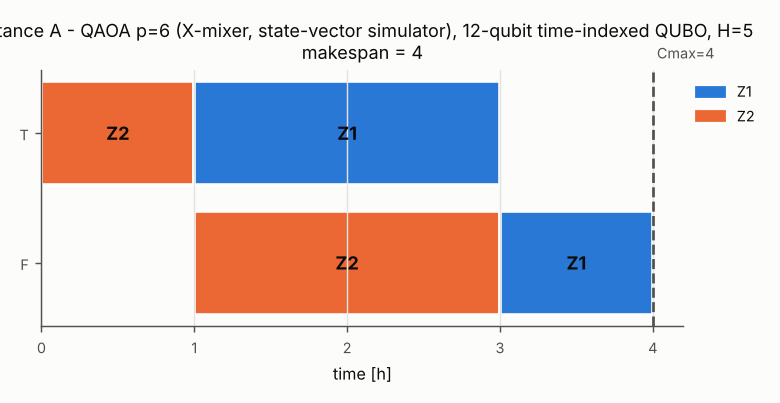
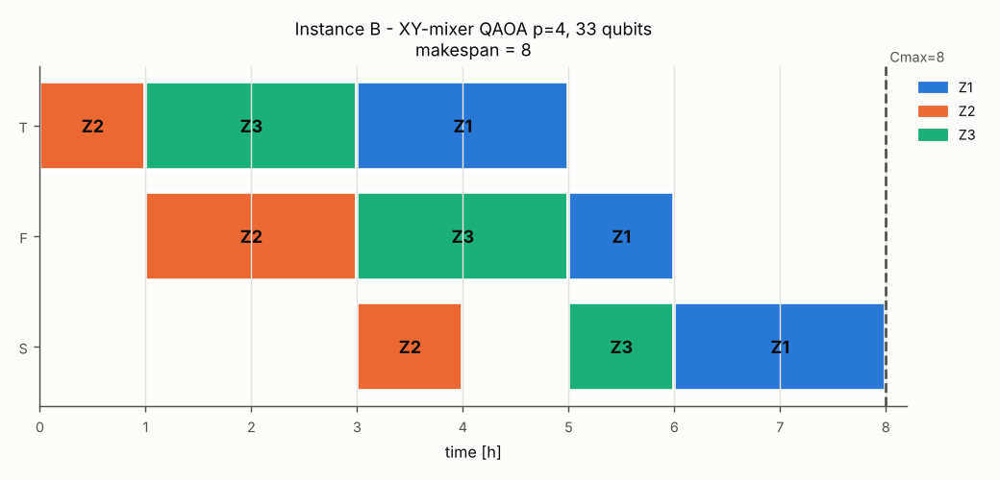

# Baseline results (Stage 1)

Generated by `python run_baseline.py` on 2026-10-18 07:41 UTC (seed 7, 4096 shots).

## Instance A - 2x2

* lower bound 4, FIFO plan 5, CP-SAT optimum 4 (OPTIMAL), brute force 4
* horizon H = 5 (makespan of the FIFO plan)
* **QUBO result: makespan 4** -> `schedule_2x2.json` (method: QAOA p=6 (X-mixer, state-vector simulator), 12-qubit time-indexed QUBO, H=5)

| pruning | qubits | quadratic terms | one-hot subspace |
|---|---|---|---|
| none | 20 | 92 | 625 |
| horizon | 18 | 76 | 400 |
| window | 12 | 28 | 81 |
| ac3 | 12 | 28 | 81 |
| sac | 12 | 28 | 81 |
| job-order code (brute force, see below) | **1** | 0 | - |

Fewest qubits: the **job-order code** (`erpq/permutation.py`), 1 code + 0 auxiliary qubits for the 2 job orders. Its coefficients are the makespans of all 2 job orders, computed classically before the QUBO exists: brute force, and the table grows as n!. The qubits hold only the job order; start times are decoded by list scheduling. Exact only for same-route flow shops with <= 3 machines and pure makespan. Certificate (all 2^1 states): 1 ground states, all optimal = **True**. QAOA X-mixer p=3: exact P(optimal) = 1.0000 (uniform sampling: 0.5000). Reported for comparison only; the delivered schedule comes from the time-indexed QUBO.

Ground-state certificate (all 2^12 states): 1 ground states, all optimal = **True**.

QAOA: QAOA X-mixer p=6, exact P(optimal) = 0.0994 (uniform sampling: 2.44e-04), sampled optimal fraction 0.108, feasible 0.393.

| p | <E> | P(optimal) | P(feasible) |
|---|---|---|---|
| 1 | 5.343 | 0.0042 | 0.0258 |
| 2 | 3.992 | 0.0196 | 0.1078 |
| 3 | 3.370 | 0.0352 | 0.1717 |
| 4 | 2.981 | 0.0413 | 0.2058 |
| 5 | 2.607 | 0.0647 | 0.2863 |
| 6 | 2.221 | 0.0994 | 0.3873 |

Qiskit gate-level circuit with the same angles: max |p_numpy - p_qiskit| = 9.0e-17.

## Instance B - 3x3

* lower bound 8, FIFO plan 8, CP-SAT optimum 8 (OPTIMAL), brute force 8
* horizon H = 8 (makespan of the FIFO plan)
* **QUBO result: makespan 8** -> `schedule_3x3.json` (method: XY-mixer QAOA p=4 (exact one-hot-subspace state-vector simulation), 33-qubit time-indexed QUBO, H=8)

| pruning | qubits | quadratic terms | one-hot subspace |
|---|---|---|---|
| none | 72 | 638 | 134217728 |
| horizon | 67 | 556 | 68841472 |
| window | 39 | 181 | 512000 |
| ac3 | 39 | 181 | 512000 |
| sac | 33 | 123 | 103680 |
| sac + domain wall | 24 | 87 | - |
| job-order code (brute force, see below) | **3** | 2 | - |

Fewest qubits: the **job-order code** (`erpq/permutation.py`), 3 code + 0 auxiliary qubits for the 6 job orders. Its coefficients are the makespans of all 6 job orders, computed classically before the QUBO exists: brute force, and the table grows as n!. The qubits hold only the job order; start times are decoded by list scheduling. Exact only for same-route flow shops with <= 3 machines and pure makespan. Certificate (all 2^3 states): 4 ground states, all optimal = **True**. QAOA X-mixer p=3: exact P(optimal) = 0.9939 (uniform sampling: 0.5000). Reported for comparison only; the delivered schedule comes from the time-indexed QUBO.

Ground-state certificate (one-hot subspace (103680 states) + penalty bound): 13 ground states, all optimal = **True**.

QAOA: XY-mixer QAOA p=4 (ring), exact P(optimal) = 0.1720 (uniform sampling: 1.25e-04), sampled optimal fraction 0.173, feasible 0.173.

| p | <E> | P(optimal) | P(feasible) |
|---|---|---|---|
| 1 | 3.301 | 0.0099 | 0.0099 |
| 2 | 2.440 | 0.0354 | 0.0354 |
| 3 | 1.929 | 0.0814 | 0.0814 |
| 4 | 1.529 | 0.1720 | 0.1720 |

Domain-wall QUBO certificate (all 2^24 states): all ground states optimal = **True**.

| solver | formulation | qubits | optimal samples | feasible samples | best makespan |
|---|---|---|---|---|---|
| simulated annealing | none | 72 | 0.396 | 0.396 | 8 |
| simulated annealing | window | 39 | 0.916 | 0.916 | 8 |
| simulated annealing | sac | 33 | 0.966 | 0.966 | 8 |
| simulated annealing | domain-wall | 24 | 0.942 | 0.942 | 8 |
| simulated annealing | permutation | 3 | 1.000 | 1.000 | 8 |
| tabu search | sac | 33 | 1.000 | 1.000 | 8 |
| VeloxQ (veloxq) | none | 72 | 0.129 | 0.171 | 8 |
| VeloxQ (veloxq) | window | 39 | 0.931 | 0.931 | 8 |
| VeloxQ (veloxq) | sac | 33 | 0.985 | 0.985 | 8 |
| VeloxQ (veloxq) | domain-wall | 24 | 0.941 | 0.941 | 8 |
| VeloxQ (veloxq) | permutation | 3 | 1.000 | 1.000 | 8 |

