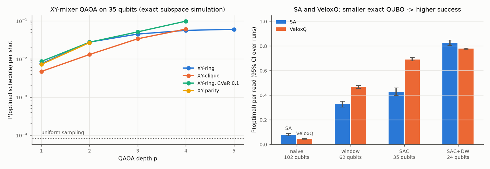

# Part 2 - Algorithm comparison on metaltech_monday

Certified horizon H* = 9, CP-SAT optimum 21. Qubits: none 102, window 62, sac 35, dw 24.

## QAOA (XY mixers, exact simulation in the one-hot subspace)

| variant | p | <E> | P(optimal) | P(feasible) | objective evaluations |
|---|---|---|---|---|---|
| XY-ring | 1 | 64.516 | 0.0075 | 0.0533 | 68 |
| XY-ring | 2 | 44.431 | 0.0277 | 0.1676 | 150 |
| XY-ring | 3 | 33.575 | 0.0450 | 0.2852 | 283 |
| XY-ring | 4 | 27.508 | 0.0562 | 0.4026 | 496 |
| XY-ring | 5 | 22.574 | 0.0601 | 0.5180 | 750 |
| XY-clique | 1 | 68.423 | 0.0047 | 0.0459 | 57 |
| XY-clique | 2 | 50.731 | 0.0131 | 0.1247 | 152 |
| XY-clique | 3 | 39.716 | 0.0339 | 0.2194 | 307 |
| XY-clique | 4 | 31.662 | 0.0608 | 0.3353 | 511 |
| XY-ring, CVaR 0.1 | 1 | 66.587 | 0.0086 | 0.0582 | 83 |
| XY-ring, CVaR 0.1 | 2 | 45.221 | 0.0275 | 0.1801 | 189 |
| XY-ring, CVaR 0.1 | 3 | 40.527 | 0.0513 | 0.2489 | 372 |
| XY-ring, CVaR 0.1 | 4 | 32.824 | 0.0983 | 0.3712 | 626 |
| XY-parity | 1 | 65.177 | 0.0072 | 0.0500 | 192 |
| XY-parity | 2 | 45.787 | 0.0268 | 0.1518 | 667 |

Parameter transfer: XY-ring angles optimised on the 3x3 baseline (p=3) give P(optimal) = 0.0416 here without any re-optimisation (own optimisation: 0.0450; uniform: 8.14e-05).

## Classical QUBO solvers (several seeds)

| solver | formulation | qubits | P(optimal)/sample | 95% CI | P(feasible) | TTS99 [samples] | TTS99 [s] |
|---|---|---|---|---|---|---|---|
| sa | naive | 102 | 0.078 | [0.069, 0.088] | 0.256 | 56.7 | 0.2462 |
| tabu | naive | 102 | 0.190 | [0.130, 0.250] | 0.510 | 21.9 | 0.4926 |
| sa | window | 62 | 0.327 | [0.303, 0.351] | 0.832 | 11.6 | 0.0244 |
| tabu | window | 62 | 1.000 | [1.000, 1.000] | 1.000 | 1.0 | 0.0213 |
| sa | SAC | 35 | 0.427 | [0.397, 0.459] | 0.999 | 8.3 | 0.0090 |
| tabu | SAC | 35 | 1.000 | [1.000, 1.000] | 1.000 | 1.0 | 0.0211 |
| sa | SAC+DW | 24 | 0.827 | [0.804, 0.848] | 1.000 | 2.6 | 0.0017 |
| tabu | SAC+DW | 24 | 1.000 | [1.000, 1.000] | 1.000 | 1.0 | 0.0211 |
| veloxq | naive | 102 | 0.043 | [0.041, 0.046] | 0.099 | 104.0 | 0.0126 |
| veloxq | window | 62 | 0.467 | [0.452, 0.479] | 0.758 | 7.3 | 0.0009 |
| veloxq | SAC | 35 | 0.690 | [0.679, 0.706] | 0.986 | 3.9 | 0.0005 |
| veloxq | SAC+DW | 24 | 0.778 | [0.772, 0.783] | 0.998 | 3.1 | 0.0003 |

VeloxQ rows: independent calls of the cloud service (it takes no seed; 3 runs per formulation). Their TTS99 [s] uses the solver time reported by the service; upload, queueing and download add about 6 s of wall time per call.

## Penalty weight sweep (multiples of the certified penalty U + 1)

| scale | penalty | ground state optimal | SA P(optimal) | XY-QAOA p=2 P(optimal) | XY-QAOA p=2 P(feasible) |
|---|---|---|---|---|---|
| 0.25 | 4.25 | True | 0.292 | 0.0600 | 0.1595 |
| 0.5 | 8.50 | True | 0.612 | 0.0439 | 0.1693 |
| 1.0 | 17.00 | True | 0.430 | 0.0352 | 0.1676 |
| 2.0 | 34.00 | True | 0.286 | 0.0311 | 0.1645 |
| 4.0 | 68.00 | True | 0.260 | 0.0291 | 0.1622 |

