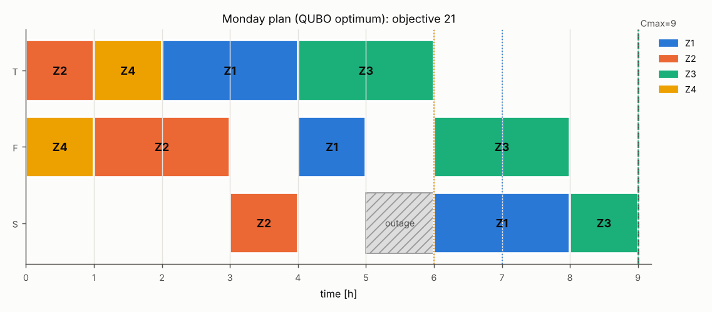
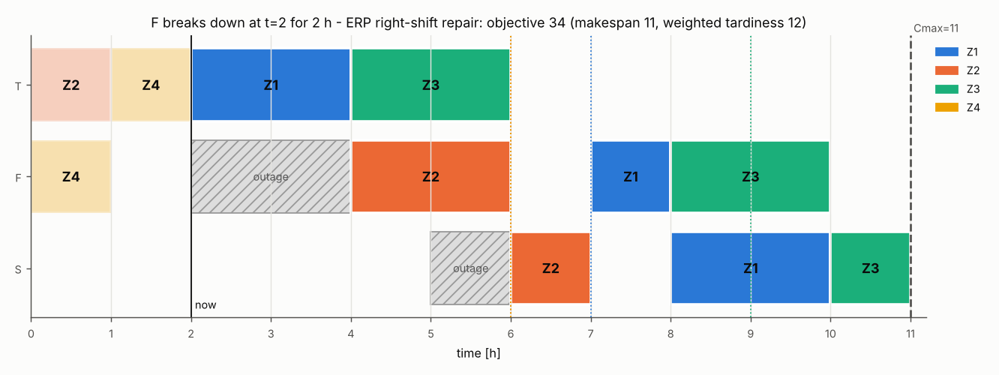
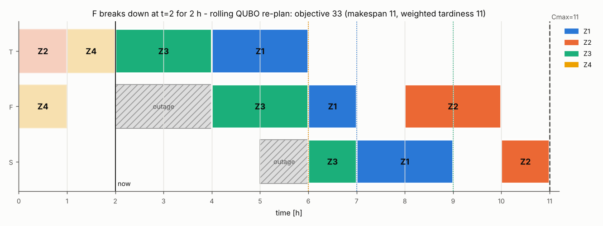

# Part 4 - Disruptions and rolling re-planning

The optimal Monday plan of `metaltech_monday` is executed until a breakdown at time t: machine m is down for d hours (the operation running on m restarts after the repair, operations running elsewhere continue). The residual problem (only remaining operations, running ones fixed, new outage window, time origin t) is re-planned as a new QUBO by horizon ascent + simulated annealing, and compared with the ERP default (right-shift: keep the planned sequence, push operations later) and CP-SAT.

* scenarios: 36
* mean improvement of the QUBO re-plan over right-shift: **0.97** cost units (95% CI 0.42 .. 1.58); improved in 31% of scenarios
* QUBO re-plan equal to the CP-SAT optimum in **100%** of scenarios with simulated annealing and in **100%** in the 'XY-QAOA' column (mean improvement over right-shift 0.97). That column runs XY-QAOA (p=3, 1024 shots) with angles optimised once on the Monday instance - no variational loop at re-planning time - whenever the one-hot subspace can be simulated (<= 2e6 states), otherwise it falls back to SA; at 0 qubits propagation alone fixes the plan. Solver that produced the column's best schedule: XY-mixer QAOA 32, exact (subspace enumeration) 1, simulated annealing 3
* residual QUBOs are small: median 18.5 qubits, max 51; horizon certificate not reached within the patience limit in 1 scenario(s) (CP-SAT confirms optimality there)
* **live VeloxQ re-plan**: the same horizon ascent with one VeloxQ call (1024 reads) per horizon that has qubits equals the CP-SAT optimum in **92%** of scenarios (mean improvement over right-shift 0.67); 63 calls, 7.51 s of solver time in total as reported by the service

| t | machine | down [h] | ops left | qubits | right-shift | QUBO + SA | QUBO + XY-QAOA | solver of XY-QAOA column | QUBO + VeloxQ | VeloxQ calls | CP-SAT |
|---|---|---|---|---|---|---|---|---|---|---|---|
| 1 | T | 1 | 9 | 22 | 24 | 23 | 23 | XY-mixer QAOA p=3 (ring) | 23 | 2 | 23 |
| 1 | T | 2 | 9 | 41 | 30 | 27 | 27 | simulated annealing | 27 | 2 | 27 |
| 1 | T | 3 | 9 | 44 | 36 | 35 | 35 | simulated annealing | 35 | 3 | 35 |
| 1 | F | 1 | 9 | 14 | 21 | 21 | 21 | XY-mixer QAOA p=3 (ring) | 21 | 1 | 21 |
| 1 | F | 2 | 9 | 51 | 34 | 30 | 30 | simulated annealing | 30 | 2 | 30 |
| 1 | F | 3 | 9 | 41 | 34 | 30 | 30 | XY-mixer QAOA p=3 (ring) | 30 | 2 | 30 |
| 1 | S | 1 | 9 | 30 | 21 | 21 | 21 | XY-mixer QAOA p=3 (ring) | 21 | 1 | 21 |
| 1 | S | 2 | 9 | 30 | 21 | 21 | 21 | XY-mixer QAOA p=3 (ring) | 21 | 1 | 21 |
| 1 | S | 3 | 9 | 28 | 21 | 21 | 21 | XY-mixer QAOA p=3 (ring) | 21 | 1 | 21 |
| 2 | T | 1 | 7 | 17 | 24 | 24 | 24 | XY-mixer QAOA p=3 (ring) | 24 | 1 | 24 |
| 2 | T | 2 | 7 | 19 | 30 | 30 | 30 | XY-mixer QAOA p=3 (ring) | 30 | 2 | 30 |
| 2 | T | 3 | 7 | 21 | 36 | 36 | 36 | XY-mixer QAOA p=3 (ring) | 36 | 3 | 36 |
| 2 | F | 1 | 8 | 30 | 34 | 33 | 33 | XY-mixer QAOA p=3 (ring) | 33 | 3 | 33 |
| 2 | F | 2 | 8 | 23 | 34 | 33 | 33 | XY-mixer QAOA p=3 (ring) | 33 | 3 | 33 |
| 2 | F | 3 | 8 | 32 | 41 | 33 | 33 | XY-mixer QAOA p=3 (ring) | 33 | 2 | 33 |
| 2 | S | 1 | 7 | 15 | 21 | 21 | 21 | XY-mixer QAOA p=3 (ring) | 21 | 1 | 21 |
| 2 | S | 2 | 7 | 13 | 21 | 21 | 21 | XY-mixer QAOA p=3 (ring) | 21 | 1 | 21 |
| 2 | S | 3 | 7 | 31 | 34 | 30 | 30 | XY-mixer QAOA p=3 (ring) | 30 | 2 | 30 |
| 3 | T | 1 | 7 | 18 | 30 | 30 | 30 | XY-mixer QAOA p=3 (ring) | 30 | 1 | 30 |
| 3 | T | 2 | 7 | 20 | 36 | 36 | 36 | XY-mixer QAOA p=3 (ring) | 36 | 2 | 36 |
| 3 | T | 3 | 7 | 22 | 42 | 42 | 42 | XY-mixer QAOA p=3 (ring) | 42 | 3 | 42 |
| 3 | F | 1 | 6 | 4 | 21 | 21 | 21 | XY-mixer QAOA p=3 (ring) | 21 | 1 | 21 |
| 3 | F | 2 | 6 | 2 | 21 | 21 | 21 | XY-mixer QAOA p=3 (ring) | 21 | 1 | 21 |
| 3 | F | 3 | 6 | 5 | 27 | 27 | 27 | XY-mixer QAOA p=3 (ring) | 27 | 2 | 27 |
| 3 | S | 1 | 6 | 2 | 21 | 21 | 21 | XY-mixer QAOA p=3 (ring) | 21 | 1 | 21 |
| 3 | S | 2 | 6 | 20 | 34 | 30 | 30 | XY-mixer QAOA p=3 (ring) | 34 | 3 | 30 |
| 3 | S | 3 | 6 | 20 | 34 | 30 | 30 | XY-mixer QAOA p=3 (ring) | 34 | 3 | 30 |
| 4 | T | 1 | 5 | 6 | 24 | 24 | 24 | XY-mixer QAOA p=3 (ring) | 24 | 1 | 24 |
| 4 | T | 2 | 5 | 9 | 27 | 27 | 27 | XY-mixer QAOA p=3 (ring) | 27 | 1 | 27 |
| 4 | T | 3 | 5 | 12 | 30 | 30 | 30 | XY-mixer QAOA p=3 (ring) | 33 | 2 | 30 |
| 4 | F | 1 | 5 | 0 | 21 | 21 | 21 | exact (subspace enumeration) | 21 | 0 | 21 |
| 4 | F | 2 | 5 | 3 | 27 | 27 | 27 | XY-mixer QAOA p=3 (ring) | 27 | 2 | 27 |
| 4 | F | 3 | 5 | 5 | 33 | 33 | 33 | XY-mixer QAOA p=3 (ring) | 33 | 3 | 33 |
| 4 | S | 1 | 5 | 2 | 21 | 21 | 21 | XY-mixer QAOA p=3 (ring) | 21 | 1 | 21 |
| 4 | S | 2 | 5 | 2 | 21 | 21 | 21 | XY-mixer QAOA p=3 (ring) | 21 | 1 | 21 |
| 4 | S | 3 | 5 | 8 | 27 | 27 | 27 | XY-mixer QAOA p=3 (ring) | 27 | 2 | 27 |

Example (F down at t=2 for 2 h):

