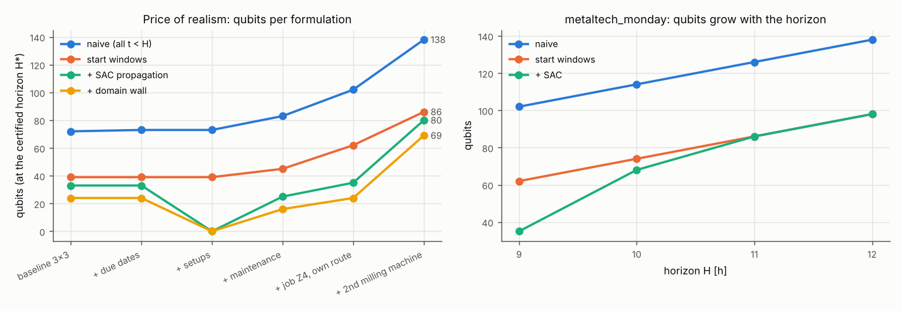

# Part 1 - Qubit reduction and the price of realism

Every QUBO below is *exact*: its ground states are optimal schedules (penalty theorem + exhaustive enumeration of the one-hot subspace, and of all 2^n states of the domain-wall QUBO when n <= 26). H* is found by horizon ascent: start at the lower bound, skip horizons that propagation proves infeasible, stop when the horizon certificate holds.

| step | ops | H* | naive @FIFO H | naive @H* | windows | AC-3 | SAC | SAC + domain wall | aux | quad. terms naive -> SAC | QUBO opt = CP-SAT | certified |
|---|---|---|---|---|---|---|---|---|---|---|---|---|
| baseline 3x3 | 9 | 8 | 72 | 72 | 39 | 39 | 33 | **24** | 0 | 638 -> 123 | 8 = 8: True | horizon True, DW True; solved by exact (subspace enumeration) |
| + due dates | 9 | 8 | 72 | 73 | 39 | 39 | 33 | **24** | 0 | 639 -> 123 | 16 = 16: True | horizon True, DW True; solved by exact (subspace enumeration) |
| + setups | 9 | 8 | 90 | 73 | 39 | 35 | 0 | **0** | 0 | 691 -> 0 | 16 = 16: True | horizon True, DW True; solved by exact (subspace enumeration) |
| + maintenance | 9 | 9 | 90 | 83 | 45 | 44 | 25 | **16** | 1 | 852 -> 57 | 21 = 21: True | horizon True, DW True; solved by exact (subspace enumeration) |
| + job Z4, own route | 11 | 9 | 132 | 102 | 62 | 61 | 35 | **24** | 2 | 1096 -> 97 | 21 = 21: True | horizon True, DW True; solved by exact (subspace enumeration) |
| + 2nd milling machine | 11 | 9 | 135 | 138 | 86 | 86 | 80 | **69** | 2 | 2073 -> 721 | 19 = 19: True | horizon True, DW None; solved by simulated annealing |

Horizon ascent traces:

* baseline 3x3: H=8: solved (33 q)
* + due dates: H=8: solved (33 q)
* + setups: H=8: solved
* + maintenance: H=8: infeasible (propagation proof), H=9: solved (25 q)
* + job Z4, own route: H=7: infeasible (propagation proof), H=8: infeasible (propagation proof), H=9: solved (35 q)
* + 2nd milling machine: H=7: infeasible (propagation proof), H=8: infeasible (propagation proof), H=9: solved (80 q)

## Horizon effect (metaltech_monday)

| H | naive | windows | SAC | one-hot subspace (SAC) |
|---|---|---|---|---|
| 9 | 102 | 62 | 35 | 331776 |
| 10 | 114 | 74 | 68 | 1814400000 |
| 11 | 126 | 86 | 86 | 51631104000 |
| 12 | 138 | 98 | 98 | 431637921792 |

