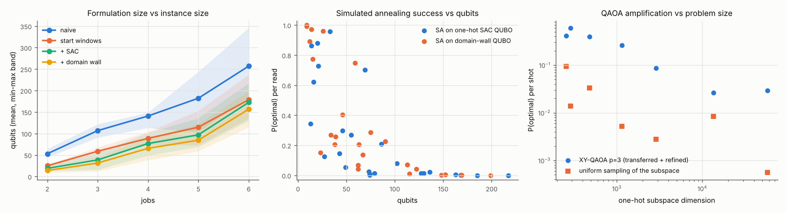

# Part 3 - Scaling and variance analysis

Random extended instances (features: due_dates, setups, routes, outage), 3 machine types, durations 1-3 h. Planning horizon = end of shift = optimal makespan + 1 h (all work must be done within the shift; the objective 2*Cmax + weighted tardiness is optimised exactly within it, CP-SAT with the same horizon is the reference). SA: 100 reads x several seeds; XY-QAOA p=3 starts from angles optimised on metaltech_monday (parameter transfer) followed by a local refinement; P(optimal) is exact (state-vector).

| jobs | instances | qubits naive | windows | SAC | SAC+DW | SA P(opt) SAC | SA P(opt) DW | QAOA p=3 P(opt) | uniform P(opt) | amplification |
|---|---|---|---|---|---|---|---|---|---|---|
| 2 | 5 | 53.0 +/- 7.3 | 25.0 +/- 1.9 | 19.0 +/- 5.7 | 14.0 +/- 5.7 | 0.588 +/- 0.336 | 0.778 +/- 0.362 | 0.2788 +/- 0.2373 | 0.024792 +/- 0.038772 | 27x |
| 3 | 5 | 106.8 +/- 12.6 | 58.8 +/- 10.0 | 38.6 +/- 14.9 | 31.4 +/- 13.1 | 0.458 +/- 0.330 | 0.557 +/- 0.343 | 0.2108 +/- 0.2566 | 0.016944 +/- 0.023177 | 32x |
| 4 | 5 | 140.8 +/- 15.6 | 88.8 +/- 11.9 | 76.8 +/- 19.5 | 65.6 +/- 19.1 | 0.075 +/- 0.080 | 0.193 +/- 0.091 | - | - | - |
| 5 | 5 | 182.2 +/- 56.8 | 114.8 +/- 32.7 | 97.0 +/- 31.9 | 84.6 +/- 30.3 | 0.151 +/- 0.308 | 0.213 +/- 0.301 | - | - | - |
| 6 | 5 | 257.0 +/- 60.0 | 178.8 +/- 37.5 | 172.6 +/- 31.8 | 156.6 +/- 30.7 | 0.004 +/- 0.006 | 0.004 +/- 0.004 | - | - | - |

Per-instance data: `scaling.json`.

